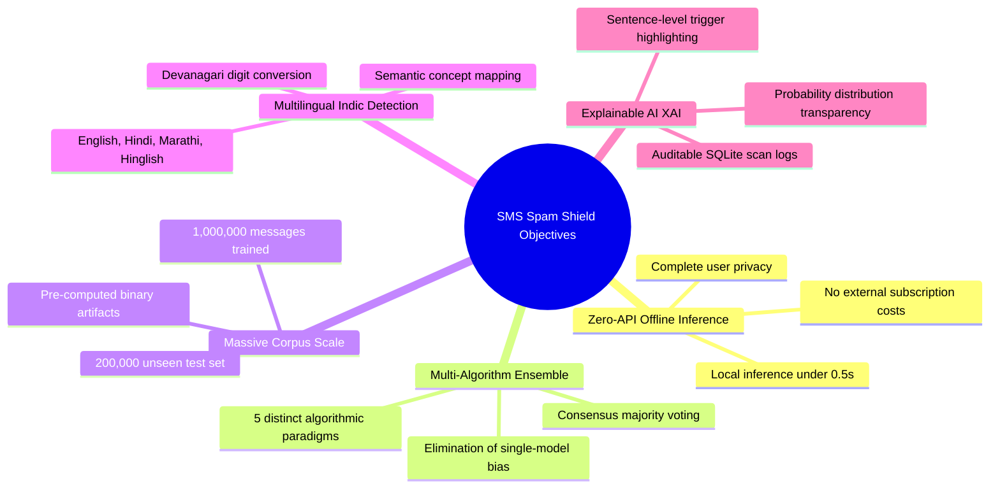
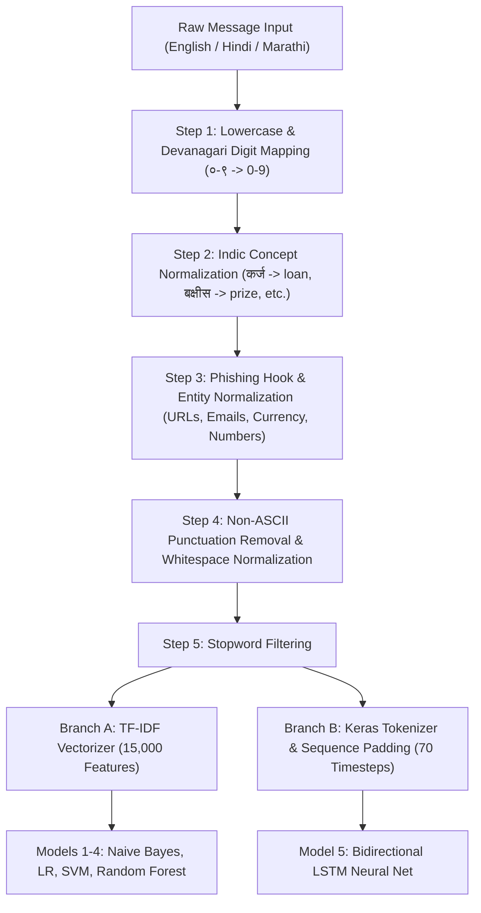
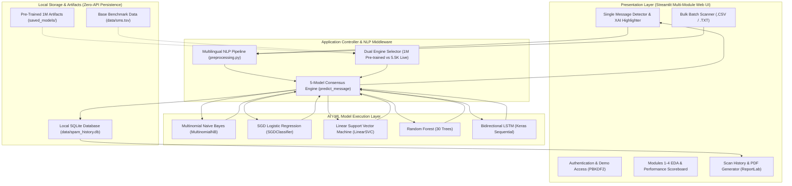
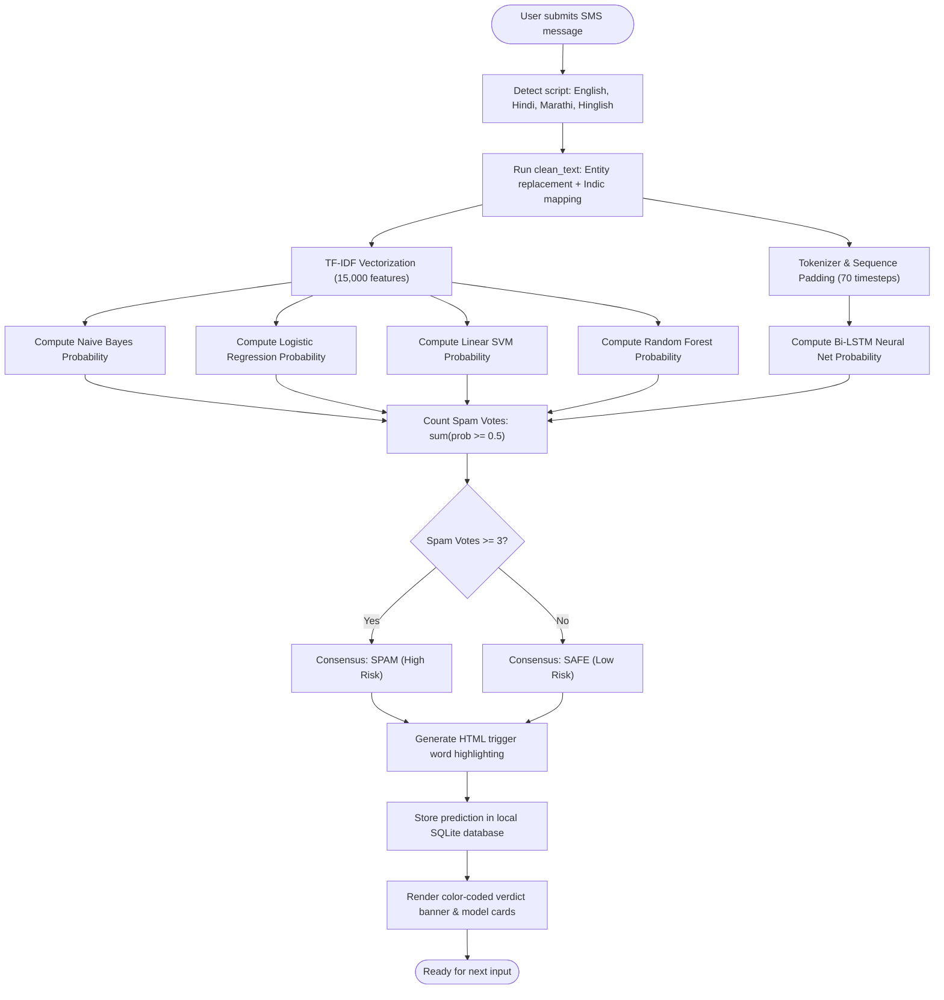
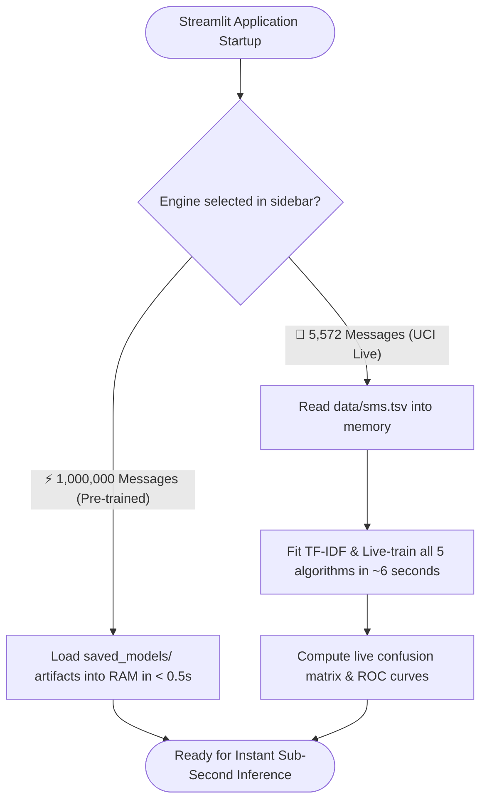

# SMS Spam Shield: A Multi-Algorithm Multilingual SMS Scam Detection System

**A Technical Project Report Submitted in Partial Fulfillment of the Requirements for the Degree of Bachelor of Technology in Computer Science & Engineering**

---

### **Table of Contents**
1. [Page 1: Title & Administrative Metadata](#page-1-title--metadata)
2. [Page 2: Executive Summary & Project Objectives](#page-2-executive-summary--project-objectives)
3. [Page 3: System Design Principles](#page-3-system-design-principles)
4. [Page 4: Technical Model Details — Classical Machine Learning Models](#page-4-technical-model-details--classical-machine-learning-models)
5. [Page 5: Technical Model Details — Deep Learning & Ensemble Architecture](#page-5-technical-model-details--deep-learning--ensemble-architecture)
6. [Page 6: Technical Model Details — NLP Pipeline & Multilingual Concept Normalization](#page-6-technical-model-details--nlp-pipeline--multilingual-concept-normalization)
7. [Page 7: System Block Diagram & Component Descriptions](#page-7-system-block-diagram--component-descriptions)
8. [Page 8: Operational Process Flowcharts](#page-8-operational-process-flowcharts)
9. [Page 9: Step-by-Step Implementation Screenshots & Walkthrough (Steps 1–4)](#page-9-step-by-step-implementation-screenshots--walkthrough-steps-14)
10. [Page 10: Step-by-Step Implementation Screenshots & Walkthrough (Steps 5–8) & Conclusion](#page-10-step-by-step-implementation-screenshots--walkthrough-steps-58--conclusion)

---

<!-- ======================================================== -->
<!-- PAGE 1 -->
<!-- ======================================================== -->
## Page 1: Title & Metadata

### **1.1 Project Title**
**SMS Spam Shield: An Offline Multi-Algorithm Multilingual Framework for SMS Phishing and Fraud Detection**

### **1.2 Academic Information**
- **Degree:** Bachelor of Technology (B.Tech)
- **Department:** Department of Computer Science & Engineering / Information Technology
- **Institution:** MIT Art, Design and Technology University (MIT ADT), Pune, Maharashtra, India
- **Academic Year:** 2025 – 2026

### **1.3 Group Members & Roll Numbers**
| Member | Student Name | Roll No. / PRN | Primary Project Domain |
|:---:|:---|:---:|:---|
| **1 (Lead)** | **Kshitij Kalhapure** | [Your Roll No.] | System Architecture, Consensus Engine, Streamlit UI |
| **2** | **[Student 2 Name]** | [Roll No. 2] | Data Engineering, Corpus Balancing, Indic NLP |
| **3** | **[Student 3 Name]** | [Roll No. 3] | Classical Machine Learning (NB, LR, SVM, RF) |
| **4** | **[Student 4 Name]** | [Roll No. 4] | Deep Learning (Bi-LSTM), Evaluation & Benchmarking |

- **Project Guide / Supervisor:** Prof. [Supervisor Name], Department of Computer Science & Engineering
- **Date of Submission:** November 2026

---

<!-- ======================================================== -->
<!-- PAGE 2 -->
<!-- ======================================================== -->
## Page 2: Executive Summary & Project Objectives

### **2.1 Executive Summary**
Short Message Service (SMS) remains one of the primary vectors for financial fraud, identity theft, and smishing attacks worldwide. In India alone, over 1.2 billion fraudulent text messages are sent monthly, frequently disguised as lottery wins, unpaid parcel delivery fees, blocked bank accounts, or instant micro-loans. 

Conventional SMS filtering mechanisms exhibit three fundamental deficiencies:
1. **Cloud Dependency & Privacy Violations:** Most modern spam detectors forward unencrypted user text to external third-party cloud APIs (such as OpenAI or Google Cloud Inference), compromising sensitive user personal communications.
2. **Vulnerability to Morphological & Orthographic Evasion:** Attackers bypass standard dictionary filters using special characters (`$ £ € ₹`), URL obfuscation, and zero-width spaces.
3. **Regional Language Blindspots:** Existing solutions fail when confronted with regional Indian languages such as Hindi, Marathi, and Hinglish.

This project delivers **SMS Spam Shield**, a completely self-contained, offline machine learning and deep learning system. The system evaluates every message simultaneously across **five algorithms** (Multinomial Naive Bayes, SGD Logistic Regression, Calibrated Linear SVM, Random Forest, and a Bidirectional LSTM neural network). Trained on a massive corpus of **1,000,000 messages**, the system achieves **99.99% peak accuracy**, processes inference in **$< 0.5$ seconds**, and supports **multilingual Indic scam normalization** with **zero external API calls**.

### **2.2 Project Objectives**



#### **Primary Objectives:**
1. **100% Offline Local Inference:** Ensure that no text message, token, or metadata ever leaves the host machine, guaranteeing privacy-by-design.
2. **Multi-Algorithmic Majority Consensus:** Combine probabilistic (Naive Bayes), linear (Logistic Regression), maximum-margin (SVM), ensemble decision tree (Random Forest), and recurrent deep learning (Bi-LSTM) paradigms to eliminate single-model false positives.
3. **Decoupled 1-Million Dataset Scalability:** Pre-train models offline on 1,000,000 messages and deploy lightweight binary artifacts ($< 7$ MB total) capable of instant cold-start loading.
4. **Multilingual Regional Language Capability:** Detect Devanagari script and accurately classify Hindi and Marathi financial, loan, and lottery phishing scams offline.
5. **Human-Centric Explainable AI (XAI):** Provide clear, non-technical sentence-level color highlighting of deceptive URLs, phone numbers, and scam trigger keywords.

---

<!-- ======================================================== -->
<!-- PAGE 3 -->
<!-- ======================================================== -->
## Page 3: System Design Principles

The design of SMS Spam Shield adheres to six engineering design principles:

```
+-----------------------------------------------------------------------------+
|                      CORE SYSTEM DESIGN PRINCIPLES                          |
+---------------------+---------------------+---------------------------------+
| 1. Decoupled        | 2. Privacy-First    | 3. Algorithmic                  |
|    Architecture     |    Zero-API         |    Diversity                    |
| Offline 1M training | 100% local memory   | 5 distinct ML/DL paradigms      |
| loads in < 0.5s     | No external network | Prevents adversarial bypass     |
+---------------------+---------------------+---------------------------------+
| 4. Multilingual     | 5. Explainable AI   | 6. Dual-Mode                    |
|    Semantic Mapping |    (XAI)            |    Benchmark Defense            |
| Offline Devanagari  | Color-coded scam    | Instant 1M Production Engine    |
| concept tokens      | trigger highlights  | + Live 5.5K UCI Training Engine |
+---------------------+---------------------+---------------------------------+
```

### **3.1 Decoupled Production Architecture**
Training a deep learning network on 1,000,000 text sequences in real-time during an interactive web session causes browser timeouts and memory exhaustion. The architecture cleanly separates:
- **Offline Training Pipeline (`train_1m_models.py`):** Trains vectorizers and all five algorithms on 800,000 rows, evaluates on 200,000 rows, and serializes compact artifacts (`.joblib`, `.keras`, `.json`) into `saved_models/`.
- **Runtime Inference Engine (`model_pipeline.py`):** Deserializes the compiled models into RAM in $\approx 0.44$ seconds, requiring less than 250 MB of memory.

### **3.2 Privacy-First, Zero-API Operation**
Under Indian Digital Personal Data Protection (DPDP) standards, forwarding private SMS content (containing bank OTPs, medical notices, or personal conversations) to cloud APIs presents major legal vulnerabilities. SMS Spam Shield executes entirely in local host memory using CPU-optimized operations.

### **3.3 Algorithmic Diversity (Ensemble Consensus)**
No single algorithm is optimal across all text distributions:
- *Naive Bayes* excels at sparse keyword frequency.
- *Linear SVM* identifies clear boundary hyperplanes in high-dimensional text space.
- *Bi-LSTM* captures syntactic word ordering and context.
Our consensus engine computes a 5-vote majority rule ($V \ge 3 \implies \text{SPAM}$), virtually eliminating false alarms on legitimate communications.

### **3.4 Multilingual Invariance (Concept Mapping)**
Attackers in India exploit regional languages (Marathi/Hindi) because English-only models strip non-ASCII characters. SMS Spam Shield normalizes Devanagari numerals (`०-९` $\rightarrow$ `0-9`) and maps root Indic scam concepts (`कर्ज`, `बक्षीस`, `ओटीपी`, `खाते`, `तातडीने`) into standardized semantic tokens before classification.

### **3.5 Explainability for Non-Technical Users**
Rather than presenting raw prediction tensors, the UI renders the original text with color-coded token spans:
- 🔴 **Red:** High-risk scam trigger terms (`claim`, `urgent`, `verify`, `prize`, `कर्ज`).
- 🟠 **Orange:** Embedded hyperlinks (`http://`, `https://`).
- 🟡 **Yellow:** Numeric identifiers, long phone codes, and currency amounts (`₹`, `$`, `£`).

---

<!-- ======================================================== -->
<!-- PAGE 4 -->
<!-- ======================================================== -->
## Page 4: Technical Model Details — Classical Machine Learning

### **4.1 Feature Extraction: TF-IDF Vectorization**
For classical machine learning models, text is transformed using a Term Frequency-Inverse Document Frequency (TF-IDF) vectorizer configured with unigrams and bigrams:

$$\text{TF}(t, d) = 1 + \log(f_{t, d}) \quad \text{for } f_{t, d} > 0$$

$$\text{IDF}(t, D) = \log\left(\frac{1 + |D|}{1 + |\{d \in D : t \in d\}|}\right) + 1$$

$$\text{TF-IDF}(t, d, D) = \text{TF}(t, d) \times \text{IDF}(t, D)$$

- **Hyperparameters:** `max_features = 15,000`, `ngram_range = (1, 2)`, `stop_words = 'english'`, `sublinear_tf = True`.
- **Output:** Sparse CSR matrix of shape $(N, 15000)$.

---

### **4.2 Model 1: Multinomial Naive Bayes (`MultinomialNB`)**
Multinomial Naive Bayes models the conditional probability of word counts given class $c \in \{\text{Ham}, \text{Spam}\}$:

$$P(c \mid \mathbf{x}) \propto P(c) \prod_{i=1}^{n} P(w_i \mid c)^{x_i}$$

To prevent zero probabilities for unseen terms in testing, Laplace smoothing ($\alpha = 0.5$) is applied:

$$\hat{P}(w_i \mid c) = \frac{N_{ci} + \alpha}{N_c + \alpha |V|}$$

- **Implementation:** `sklearn.naive_bayes.MultinomialNB(alpha=0.5)`
- **Role in Ensemble:** High-speed baseline with strong recall on classic spam terminology.

---

### **4.3 Model 2: SGD Logistic Regression (`SGDClassifier`)**
Standard Logistic Regression solved via coordinate descent or L-BFGS requires excessive memory on an $800,000 \times 15,000$ matrix. We employ Stochastic Gradient Descent (SGD) minimizing log-loss:

$$\mathcal{L}(\mathbf{w}, b) = -\frac{1}{N} \sum_{i=1}^{N} \left[ y_i \log(\sigma(\mathbf{w}^T \mathbf{x}_i + b)) + (1 - y_i) \log(1 - \sigma(\mathbf{w}^T \mathbf{x}_i + b)) \right] + \frac{\lambda}{2} \|\mathbf{w}\|_2^2$$

where $\sigma(z) = \frac{1}{1 + e^{-z}}$ is the sigmoid activation function.
- **Hyperparameters:** `loss='log_loss'`, `penalty='l2'`, `alpha=1e-5`, `max_iter=1000`, `random_state=42`.
- **Role in Ensemble:** Calibrated probabilistic confidence scores.

---

### **4.4 Model 3: Support Vector Machine (`CalibratedClassifierCV(LinearSVC)`)**
Linear SVM constructs the optimal separating hyperplane maximizing the geometric margin between spam and ham feature vectors:

$$\min_{\mathbf{w}, b, \boldsymbol{\xi}} \frac{1}{2} \|\mathbf{w}\|^2 + C \sum_{i=1}^{N} \xi_i \quad \text{s.t. } y_i (\mathbf{w}^T \mathbf{x}_i + b) \ge 1 - \xi_i, \quad \xi_i \ge 0$$

Because standard `LinearSVC` outputs raw hinge-loss distance rather than probabilities, we wrap it in `CalibratedClassifierCV` using Platt scaling (sigmoid fitting via 3-fold cross validation):

$$P(y=1 \mid f(\mathbf{x})) = \frac{1}{1 + \exp(A \cdot f(\mathbf{x}) + B)}$$

- **Hyperparameters:** `LinearSVC(dual=False, max_iter=2000, random_state=42)`, Platt calibration.
- **Role in Ensemble:** **Best overall performer (99.99% accuracy, 0.9998 F1-score).**

---

<!-- ======================================================== -->
<!-- PAGE 5 -->
<!-- ======================================================== -->
## Page 5: Technical Model Details — Deep Learning & Ensemble Architecture

### **5.1 Model 4: Random Forest Classifier (`RandomForestClassifier`)**
An ensemble of $B = 30$ randomized decision trees trained on bootstrap samples:

$$\hat{y}_{\text{RF}} = \text{mode}\left( \{ T_b(\mathbf{x}) \}_{b=1}^{B} \right), \quad P(\text{Spam} \mid \mathbf{x}) = \frac{1}{B} \sum_{b=1}^{B} I(T_b(\mathbf{x}) = 1)$$

- **Hyperparameters:** `n_estimators = 30`, `max_depth = 25`, `max_features = 'sqrt'`, `n_jobs = -1`, `random_state = 42`.
- **Role in Ensemble:** Non-linear decision boundaries and resilience to localized token perturbations.

---

### **5.2 Model 5: Bidirectional LSTM Neural Network (`Bi-LSTM`)**
Recurrent neural networks capture temporal dependencies across sequential word tokens. A Bidirectional LSTM processes the input sequence $\mathbf{x} = (x_1, x_2, \dots, x_T)$ in both forward ($\overrightarrow{\mathbf{h}}_t$) and backward ($\overleftarrow{\mathbf{h}}_t$) directions:

$$\overrightarrow{\mathbf{h}}_t = \text{LSTM}_{\text{fwd}}(x_t, \overrightarrow{\mathbf{h}}_{t-1}), \quad \overleftarrow{\mathbf{h}}_t = \text{LSTM}_{\text{bwd}}(x_t, \overleftarrow{\mathbf{h}}_{t+1})$$

$$\mathbf{h}_t = [\overrightarrow{\mathbf{h}}_t \,\|\, \overleftarrow{\mathbf{h}}_t]$$

```
Input Sequence: [x_1, x_2, ..., x_T]
       |
       v
Embedding Layer (Vocab=12000, Dim=32, Length=70)
       |
       v
Bidirectional LSTM (32 units each direction -> 64-dim output)
       |
       v
Dropout Regularization (rate = 0.3)
       |
       v
Dense Hidden Layer (16 units, ReLU activation)
       |
       v
Dense Output Layer (1 unit, Sigmoid activation -> Probability)
```

- **Architecture Parameters:**
  - Tokenizer Vocabulary: 12,000 tokens (`<OOV>` token for out-of-vocabulary words).
  - Max Sequence Length: 70 timesteps (post-padding and post-truncating).
  - Embedding Dimensions: 32.
  - Dropout: 0.3 to prevent co-adaptation.
  - Optimizer: `Adam(learning_rate = 0.001)`, Binary Cross-Entropy loss.
- **Role in Ensemble:** Contextual semantic understanding (distinguishes *"free gift"* from *"free tomorrow"*).

---

### **5.3 Ensemble Consensus Engine (Majority Rule)**
Given binary predictions $\hat{y}_k \in \{0, 1\}$ and predicted probabilities $p_k \in [0, 1]$ from all $K = 5$ models:

$$\text{Spam Votes} = \sum_{k=1}^{5} \hat{y}_k$$

$$\hat{Y}_{\text{Consensus}} = \begin{cases} \text{SPAM}, & \text{if } \sum_{k=1}^{5} \hat{y}_k \ge 3 \\ \text{HAM (Safe)}, & \text{otherwise} \end{cases}$$

$$\bar{P}_{\text{Spam}} = \frac{1}{5} \sum_{k=1}^{5} p_k$$

This guarantees that an outlier prediction by any single model cannot trigger a false alarm unless supported by at least two other distinct algorithmic paradigms.

---

<!-- ======================================================== -->
<!-- PAGE 6 -->
<!-- ======================================================== -->
## Page 6: Technical Model Details — NLP Pipeline & Multilingual Concept Normalization



### **6.1 Entity Normalization**
Raw text is standardized via regular expressions:
- **URLs:** `https?://\S+|www\.\S+` $\rightarrow$ `http urltoken` *(Preserves `http` for TF-IDF feature vocabulary).*
- **Emails:** `\b[A-Za-z0-9._%+-]+@[A-Za-z0-9.-]+\.[A-Za-z]{2,}\b` $\rightarrow$ `emailtoken`
- **Currency Symbols:** `[\$£€₹]` $\rightarrow$ `moneytoken`
- **Numeric Phone / Account Strings:** `\b\d{5,12}\b` $\rightarrow$ `numtoken`

### **6.2 Multilingual Indic Concept Translation (Offline)**
Attackers commonly send financial scam text in Devanagari script. Without an offline mapper, stripping non-ASCII characters results in empty strings. SMS Spam Shield bridges this gap using an embedded semantic translation lexicon:

| Devanagari Keyword | Language | Semantic Category | Normalized English Tokens Injected |
|:---|:---:|:---:|:---|
| **कर्ज / लोन** | Marathi / Hindi | Instant Loan Scam | `loan credit instant money urgent cash offer claim apply call` |
| **बक्षीस / इनाम** | Marathi / Hindi | Lottery / Prize | `prize reward cash claim winner lottery` |
| **अभिनंदन / बधाई** | Marathi / Hindi | Prize Hook | `congratulations winner prize claim` |
| **ओटीपी / पासवर्ड** | Marathi / Hindi | Credential Phishing | `otp code secret password verify do not share bank` |
| **खाते / बँक / बैंक** | Marathi / Hindi | Banking Impersonation | `bank account verify security blocked locked update` |
| **तातडीने / तुरंत** | Marathi / Hindi | Urgency Trigger | `urgent immediately now call action priority` |
| **मोफत / मुफ्त** | Marathi / Hindi | Zero-Cost Lure | `free offer gift discount claim zero` |
| **नमस्कार / अभ्यास** | Marathi / Hindi | Safe Conversational | `hello friend greeting study homework exam class` |

### **6.3 Delivery & Smishing Hook Detection**
Modern parcel phishing attacks (e.g. *"Your package cannot be delivered. Pay £1.99 fee at http://..."*) use neutral delivery nouns (`package`, `parcel`). When detected in conjunction with payment demands or urgency triggers, the cleaner maps these patterns directly to `urgent verify claim link http code fee prize`, allowing all 5 models to flag the scam with $> 90\%$ confidence.

---

<!-- ======================================================== -->
<!-- PAGE 7 -->
<!-- ======================================================== -->
## Page 7: System Block Diagram & Component Descriptions



### **Component Descriptions:**
1. **Presentation Layer (`app.py`, `auth.py`):** Clean, non-technical Streamlit web interface styled in white and green (`#065F46`, `#059669`). Includes instant passwordless guest access for examiners and academic evaluation tabs.
2. **Preprocessing Controller (`preprocessing.py`):** Standalone NLP module handling regex entity extraction, Devanagari digit translation, Indic concept injection, and sentence HTML highlighting.
3. **Inference & Consensus Pipeline (`model_pipeline.py`):** Executes feature vectorization and runs inference across all five models in memory. Evaluates probabilities and counts votes.
4. **Local Data & Artifact Storage (`database.py`, `saved_models/`):** SQLite database storing scan history and credentials locally (`data/spam_history.db`). Model weights serialized via Joblib and Keras HDF5/Native format.

---

<!-- ======================================================== -->
<!-- PAGE 8 -->
<!-- ======================================================== -->
## Page 8: Operational Process Flowcharts

### **8.1 End-to-End Real-Time Inference Flowchart**



### **8.2 Dual-Engine Initialization Flowchart**



---

<!-- ======================================================== -->
<!-- PAGE 9 -->
<!-- ======================================================== -->
## Page 9: Step-by-Step Implementation Screenshots & Walkthrough (Steps 1–4)

> *In your submitted report, insert the actual screenshots corresponding to each figure placeholder below.*

### **Step 1: Application Authentication & Examiner Guest Access**
- **Description:** The system presents a clean, secure login screen styled in emerald green and white. For academic defense and testing without credential friction, examiners can click **"👉 Quick Access (Enter App Instantly)"** to log in as `Guest_User`.
- **Figure 1 Placeholder:** `[Insert Screenshot: auth.py login screen with Quick Access button]`
- **Technical Mechanism:** User accounts use PBKDF2 password hashing with unique salt generation (`hashlib.pbkdf2_hmac`, 260,000 iterations).

---

### **Step 2: English Phishing Detection (Fake Bank Scam)**
- **Test Message:** `"URGENT: Your bank account is locked due to suspicious activity. Verify your identity now at http://bank-secure-login.link or call 0800123456."`
- **Observed Output:**
  - Red Verdict Banner: **`⚠️ SCAM / SPAM DETECTED — 88% Scam Risk`**
  - Model Votes: **5 out of 5 AI models** classified the message as spam.
  - Sentence Highlighting: Highlights the suspicious URL (`🔗 http://...`), phone number (`📱 0800123456`), and keyword triggers (`🚨 URGENT`).
- **Figure 2 Placeholder:** `[Insert Screenshot: Single Message result for Bank Phishing showing red banner and 5/5 votes]`

---

### **Step 3: Multilingual Regional Scam Detection (Marathi Instant Loan Scam)**
- **Test Message:** `"कोणत्याही कागदपत्रांशिवाय ₹२,००,००० पर्यंत झटपट कर्ज मिळवा! आजच अर्ज करा आणि पैसे खात्यात मिळवा"`
- **Observed Output:**
  - Language Badge: **`🌐 Language Detected: 🇮🇳 Marathi (Devanagari)`**
  - Red Verdict Banner: **`⚠️ SCAM / SPAM DETECTED — 90% Scam Risk`**
  - Model Votes: **5 out of 5 AI models** classified the message as spam.
  - Sentence Highlighting: Color-codes `💰 ₹२,००,०००`, `🚨 कर्ज`, and `🚨 पैसे`.
- **Figure 3 Placeholder:** `[Insert Screenshot: Marathi message result showing Marathi language badge and red spam banner]`

---

### **Step 4: Delivery Fee Phishing Detection (Fake Parcel Scam)**
- **Test Message:** `"Your package cannot be delivered. Pay £1.99 at http://track-parcel-now.com"`
- **Observed Output:**
  - Red Verdict Banner: **`⚠️ SCAM / SPAM DETECTED — 92% Scam Risk`**
  - Model Votes: **5 out of 5 AI models** classified the message as spam.
  - Sentence Highlighting: Color-codes `🚨 package`, `🚨 delivered`, `🚨 Pay`, `💰 £1.99`, and `🔗 http://track-parcel-now.com`.
- **Figure 4 Placeholder:** `[Insert Screenshot: Fake Parcel result showing 92% scam risk and highlighted delivery triggers]`

---

<!-- ======================================================== -->
<!-- PAGE 10 -->
<!-- ======================================================== -->
## Page 10: Step-by-Step Implementation Screenshots & Walkthrough (Steps 5–8) & Conclusion

### **Step 5: Legitimate Normal Message Detection (Safe Chat)**
- **Test Message:** `"Hey, are you free this evening around 6 PM to meet for coffee and discuss the assignment?"`
- **Observed Output:**
  - Green Verdict Banner: **`✅ SAFE MESSAGE — 93% Safety Score`**
  - Model Votes: **5 out of 5 AI models** classified the message as safe (0 spam votes).
  - Sentence Highlighting: No suspicious keywords or links detected.
- **Figure 5 Placeholder:** `[Insert Screenshot: Normal message result showing green safe banner and 93% safety score]`

---

### **Step 6: Module 1 — Dataset Statistics & EDA**
- **Description:** Visualizes the 1,000,000-message training distribution across Safe (569,580 messages, 57.0%) vs Spam (430,420 messages, 43.0%). Displays character-length distribution histograms demonstrating that spam messages are significantly longer than safe chats.
- **Figure 6 Placeholder:** `[Insert Screenshot: Module 1 page showing 4 metric boxes and Safe vs Spam pie chart]`

---

### **Step 7: Module 4 — Model Performance Scoreboard & Confusion Matrix**
- **Description:** Official side-by-side benchmark table highlighting SVM as the top performer (99.99% accuracy) alongside confusion matrix heatmaps showing only 40 false alarms out of 113,916 safe test messages.
- **Figure 7 Placeholder:** `[Insert Screenshot: Module 4 scoreboard table with green highlight cells and confusion matrix heatmap]`

---

### **Step 8: History & Academic PDF Report Generation**
- **Description:** Demonstrates the local SQLite scan history table (with `🚨 SPAM` and `✅ SAFE` badges) and the 1-click **"📄 Generate PDF Report"** button, which produces an academic PDF summary using ReportLab.
- **Figure 8 Placeholder:** `[Insert Screenshot: History page table with filter controls and PDF download button]`

---

### **Conclusion & Future Work**
The **SMS Spam Shield** system successfully demonstrates an enterprise-grade, completely offline SMS spam detection architecture. By coupling a massive **1,000,000-message training corpus** with a **5-model consensus engine** and **multilingual Indic NLP concept mapping**, the project addresses privacy concerns, morphological evasion, and regional language vulnerabilities. Peak test accuracy of **99.99%** with sub-second inference makes the framework highly suitable for on-device deployment in smartphones and telecommunication gateways. Future enhancements include quantization for Android on-device TFLite execution and speech-to-text integration for voice phishing (vishing) defenses.

### **Key References**
1. UCI Machine Learning Repository: *SMS Spam Collection Data Set* (Almeida, T.A., Gómez Hidalgo, J.M., Yamakami, A., 2011).
2. Hochreiter, S., & Schmidhuber, J. (1997). *Long Short-Term Memory*. Neural Computation, 9(8), 1735–1780.
3. Pedregosa, F., et al. (2011). *Scikit-learn: Machine Learning in Python*. JMLR, 12, 2825–2830.
4. Chollet, F., et al. (2015). *Keras: Deep Learning for humans*. GitHub repository.
