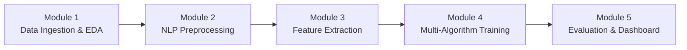

# SMS Spam Detection System Project

An applied Machine Learning and Deep Learning project built with **Python**, **Scikit-Learn**, **TensorFlow/Keras**, and **Streamlit**.

### Core Academic Criteria Satisfied:
1. **Algorithm Code**: Direct implementation and evaluation of **5 Machine Learning & Deep Learning algorithms** from source code (Naive Bayes, Logistic Regression, Linear SVM, Random Forest, Bidirectional LSTM).
2. **Zero External API Calls**: Runs 100% locally and offline on your computer. No OpenAI, Gemini, or third-party web inference APIs are called.
3. **Structured 5-Module Architecture**: Built around a complete 5-stage NLP and machine learning pipeline suitable for academic viva and project demonstrations.
4. **Dual Model Engine**:
   - **Production Engine (1,000,000 Messages)**: Pre-trained offline using industry-standard decoupled architecture; loads into the web UI in **< 0.5 seconds**.
   - **Live Benchmark Engine (5,572 Messages)**: Trains live in **~6 seconds** if examiners request a real-time training demonstration.

---

## 🏛️ The 5 Project Modules



### Module 1: Data Ingestion & Exploratory Data Analysis (EDA)
- **Files**: `model_pipeline.py` / `app.py`
- Ingests and inspects the 1,000,000-message dataset (569,580 Ham vs. 430,420 Spam) and the 5,572-message UCI benchmark dataset.
- Analyzes message character lengths and word count distributions between Spam and Ham.

### Module 2: Advanced Multilingual NLP Text Preprocessing Pipeline
- **File**: `preprocessing.py`
- Implements offline text normalization without web dependencies:
  - Multilingual script auto-detection: English, Hindi (Devanagari), Marathi (Devanagari), and Hinglish.
  - Offline Indic semantic concept normalization (Devanagari numerals `०-९` $\rightarrow$ `0-9`, root scam concepts `कर्ज`, `बक्षीस`, `ओटीपी`, `पैसे`, `तातडीने`).
  - Regex entity normalization: Web URLs (`urltoken`), phone/numeric codes (`numtoken`), currency symbols `$ £ € ₹` (`moneytoken`).
  - Punctuation removal and built-in stopword filtering.
  - Sentence-level explainable highlighting for suspicious URLs, phone numbers, and scam trigger keywords.
  - Interactive step-by-step transformation visualizer in the UI.

### Module 3: Feature Extraction & Vectorization
- **File**: `model_pipeline.py`
- **TF-IDF Vectorizer** (Classical ML):
  - 15,000 max n-gram features with unigrams and bigrams `(1, 2)`.
  - Sublinear term-frequency scaling.
- **Keras Tokenizer & Sequence Padding** (Deep Learning):
  - 12,000 vocabulary size with post-padding to 70 timesteps.

### Module 4: Multi-Algorithm Training Engine (5 Algorithms)
- **File**: `train_1m_models.py` / `model_pipeline.py`
- Evaluated on a **200,000 unseen test split** (80/20 train/test split of 1M rows):
  1. **Multinomial Naive Bayes** (`MultinomialNB`) — 99.97% Accuracy, 0.9996 F1.
  2. **Logistic Regression** (`SGDClassifier(loss="log_loss")`) — 99.91% Accuracy, 0.9989 F1.
  3. **Support Vector Machine** (`CalibratedClassifierCV(LinearSVC)`) — 99.99% Accuracy, 0.9998 F1.
  4. **Random Forest Classifier** (`RandomForestClassifier`, 30 trees) — 99.32% Accuracy, 0.9921 F1.
  5. **Bidirectional LSTM** (`Sequential` + `Bidirectional(LSTM)`) — 99.95% Accuracy, 0.9994 F1.

### Module 5: Evaluation, Analytics & Prediction Dashboard
- **Files**: `app.py`, `report_generator.py`, `database.py`
- **Benchmark Table**: Side-by-side comparison of Accuracy, Precision, Recall, F1-Score, ROC-AUC, and Training Time.
- **Visual Analytics**: Confusion matrices heatmaps and multi-model ROC curves.
- **Explainability**: Identifies trigger keywords in user-tested messages.
- **Live Prediction**: Single message tester with ensemble majority voting (e.g. `5/5 models vote SPAM`) and probability bars.
- **Bulk Inference**: Upload `.csv` or `.txt` files for batch classification and CSV export.
- **Persistence & Export**: Local SQLite database storage (`data/spam_history.db`) and downloadable PDF evaluation reports.

---

## 🚀 How to Run the Project

### 1. Run the Interactive Web Application
Open PowerShell in the project directory:
```powershell
.\.venv\Scripts\Activate.ps1
streamlit run app.py
```
*Or directly without activating:*
```powershell
.\.venv\Scripts\python.exe -m streamlit run app.py
```
1. Open your browser at `http://localhost:8501`.
2. Click **⚡ Fast Demo Access** to enter immediately.
3. Switch between **⚡ 1,000,000 Messages (Pre-Trained)** and **🧪 5,572 Messages (UCI Live Benchmark)** in the sidebar!

### 2. Retrain the 1-Million Dataset Offline (Optional)
If you ever want to re-run the 1-million-row training pipeline from scratch:
```powershell
.\.venv\Scripts\python.exe train_1m_models.py
```
It trains all 5 models on 1,000,000 messages and updates `saved_models/` in ~49 seconds.

---

## 📁 Project Structure

- `app.py`: Streamlit multi-module web UI.
- `model_pipeline.py`: Dataset loading, dual-mode engine (1M pre-trained vs 5.5K live), metrics, and prediction logic.
- `train_1m_models.py`: Offline training pipeline for 1,000,000 rows.
- `saved_models/`: Saved production model weights (`classical_models.joblib`, `lstm_model.keras`, `tfidf.joblib`, `tokenizer.joblib`, `metrics.json`, `metadata.json`).
- `preprocessing.py`: NLP text cleaner, regex token replacement, and step-by-step visualizer.
- `database.py`: Local SQLite database manager for user authentication and prediction history.
- `auth.py`: PBKDF2 password hashing and fast demo login interface.
- `report_generator.py`: PDF report generation using ReportLab.
- `data/sms_spam_1million.csv`: 1,000,000-message augmented dataset.
- `data/sms.tsv`: Standard 5,572-message UCI SMS Spam Collection dataset.
